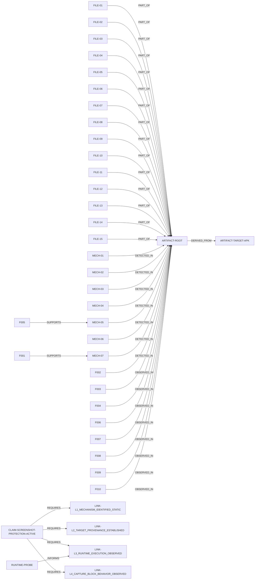

# ReelSec Evidence Report

## Causal verdict

**Claim:** The application actively blocks screenshots/screen-recording of protected content.

**Verdict: NOT_PROVEN** (rule: ALL_LINKS_MUST_BE_CONFIRMED)

| Link | Status | Detail |
|---|---|---|
| L1_MECHANISM_IDENTIFIED_STATIC | CONFIRMED | capture-specific static mechanism identified (callbacks/symbols/FLAG_SECURE pattern) |
| L2_TARGET_PROVENANCE_ESTABLISHED | INDICATOR | target hash on record; analyzed tree derived from it (tree scan, no container hash comparison) |
| L3_RUNTIME_EXECUTION_OBSERVED | NOT_PROVEN | runtime probe observed no matching target events (status=RUNTIME_ENVIRONMENT_UNAVAILABLE reason_code=ADB_UNAVAILABLE) |
| L4_CAPTURE_BLOCK_BEHAVIOR_OBSERVED | NOT_PROVEN | no bounded behavioral capture-block observation recorded |

Missing for confirmation: L2_TARGET_PROVENANCE_ESTABLISHED, L3_RUNTIME_EXECUTION_OBSERVED, L4_CAPTURE_BLOCK_BEHAVIOR_OBSERVED

## Findings by tier

### CONFIRMED (2)

- **F001** [PACKER] App-hardening shell 'SecShell' is present in the analyzed artifact.
  - basis: STRUCTURAL_MATCH: manifest/lib/asset signatures
  - evidence: manifest:com.secshell.
  - evidence: native_lib:libsecshell-x86.so
- **F002** [PROVENANCE] Campaign target APK hash on record: e67f2a69a108e5fb36f98eb6ca5fdd1030872f43d216b4163fb3e7c999deb278
  - basis: RECORD: campaign provenance file
  - evidence: e67f2a69a108e5fb36f98eb6ca5fdd1030872f43d216b4163fb3e7c999deb278

### INDICATOR (6)

- **F003** [DRM_PROTECTION] DRM subsystem strings: 62 relevant indicator hit(s) across 4 file(s).
  - basis: STATIC_PATTERN_MATCH
  - why not higher: presence confirmed; security behavior not observed at runtime
  - evidence: files: lib/arm64-v8a/libprotect.so, lib/arm64-v8a/libsaasCorePlayer.so, lib/armeabi-v7a/libprotect.so, lib/armeabi-v7a/libsaasCorePlayer.so
  - evidence: sample: AMediaDrm_getPropertyByteArray
  - evidence: sample: AMediaDrm_createByUUID
  - evidence: sample: AMediaDrm_release
- **F004** [NATIVE_CAPTURE] capture-related native strings: 21 relevant indicator hit(s) across 4 file(s).
  - basis: STATIC_PATTERN_MATCH
  - why not higher: presence confirmed; security behavior not observed at runtime
  - evidence: files: lib/arm64-v8a/libalivcffmpeg.so, lib/arm64-v8a/libsaasCorePlayer.so, lib/armeabi-v7a/libalivcffmpeg.so, lib/armeabi-v7a/libsaasCorePlayer.so
  - evidence: sample: Movie/video screen capture
  - evidence: sample: nativeOnCaptureScreen
  - evidence: sample: onCaptureScreen
- **F005** [NATIVE_SYMBOLS] capture-related exported native symbols: 11 relevant indicator hit(s) across 5 file(s).
  - basis: STATIC_PATTERN_MATCH
  - why not higher: exported symbol presence confirmed; invocation not observed
  - evidence: files: lib/arm64-v8a/libcrashlytics-common.so, lib/arm64-v8a/libprotect.so, lib/armeabi-v7a/libcrashlytics-common.so, lib/armeabi-v7a/libprotect.so, lib/armeabi-v7a/libsaasCorePlayer.so
  - evidence: sample: ptrace
  - evidence: sample: AMediaDrm_getPropertyByteArray
  - evidence: sample: AMediaDrm_createByUUID
- **F006** [PROTECTED_CONTENT] protected-content buffer usage: 8 relevant indicator hit(s) across 2 file(s).
  - basis: STATIC_PATTERN_MATCH
  - why not higher: presence confirmed; security behavior not observed at runtime
  - evidence: files: lib/arm64-v8a/libsaasCorePlayer.so, lib/armeabi-v7a/libsaasCorePlayer.so
  - evidence: sample: DRM-protected content cannot be decrypted without proper keys
  - evidence: sample: Use a certified device for DRM-protected content
  - evidence: sample: setForceInsecureDecoder
- **F007** [SCREEN_CAPTURE_CALLBACKS] screen-capture callback surface: 5 relevant indicator hit(s) across 2 file(s).
  - basis: STATIC_PATTERN_MATCH
  - why not higher: presence confirmed; security behavior not observed at runtime
  - evidence: files: lib/arm64-v8a/libsaasCorePlayer.so, lib/armeabi-v7a/libsaasCorePlayer.so
  - evidence: sample: onCaptureScreen
  - evidence: sample: nativeOnCaptureScreen
  - evidence: sample: gj_NativePlayer_onCaptureScreen
- **F008** [TAMPER_RESISTANCE] anti-instrumentation strings: 167 relevant indicator hit(s) across 8 file(s).
  - basis: STATIC_PATTERN_MATCH
  - why not higher: presence confirmed; security behavior not observed at runtime
  - evidence: files: lib/arm64-v8a/libSecShell-x86.so, lib/arm64-v8a/libSecShell.so, lib/arm64-v8a/libcrashlytics-common.so, lib/armeabi-v7a/libSecShell-x86.so, lib/armeabi-v7a/libSecShell.so
  - evidence: sample: _Z23is_magisk_check_processP7_JNIEnvP7_jclass
  - evidence: sample: ptrace
  - evidence: sample: no ptrace

### NOT_PROVEN (1)

- **F010** [CLAIM] Causal claim: the application actively blocks screenshots/screen-recording.
  - basis: CAUSAL_CHAIN_GATE
  - why not higher: chain incomplete: L2_TARGET_PROVENANCE_ESTABLISHED, L3_RUNTIME_EXECUTION_OBSERVED, L4_CAPTURE_BLOCK_BEHAVIOR_OBSERVED
  - evidence: link:L1_MECHANISM_IDENTIFIED_STATIC=CONFIRMED
  - evidence: link:L2_TARGET_PROVENANCE_ESTABLISHED=INDICATOR
  - evidence: link:L3_RUNTIME_EXECUTION_OBSERVED=NOT_PROVEN
  - evidence: link:L4_CAPTURE_BLOCK_BEHAVIOR_OBSERVED=NOT_PROVEN

### UNRELATED (1)

- **F009** [TAMPER_RESISTANCE] anti-instrumentation strings: 2 hit(s) inside third-party SDK paths (classified unrelated).
  - basis: NOISE_CLASSIFICATION: third-party SDK context
  - evidence: files: unknown/mozilla/public-suffix-list.txt

## Evidence graph

Nodes: 40, edges: 38

## Boundary

This report classifies evidence only. It never patches, disables, injects, signs, or bypasses any protection mechanism.

causal_proof: false
